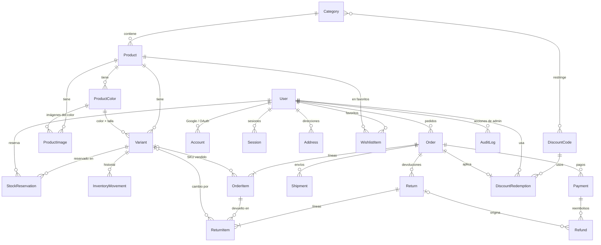

# Modelo de datos — DE LUX

Fuente de verdad: [`prisma/schema.prisma`](../prisma/schema.prisma). Este documento explica el modelo; si difieren, manda el esquema.

- **Base de datos:** PostgreSQL 18 local (Windows), puerto `3001`, base `phenomenon`. Conexión en `.env` → `DATABASE_URL`.
- **ORM:** Prisma 6 (`@prisma/client`). Migraciones en `prisma/migrations/`.
- **Datos de prueba:** `prisma/seed.ts` los genera a partir de los mocks de la UI (`src/lib/data/*`). Es idempotente.

## Comandos

```bash
npm run db:migrate   # prisma migrate dev — crea/aplica migraciones tras cambiar el esquema
npm run db:seed      # prisma db seed — carga los datos de prueba (se puede repetir)
npm run db:studio    # prisma studio — explorar/editar datos en el navegador
npm run db:reset     # borra la base, reaplica migraciones y vuelve a sembrar (¡destructivo!)
```

`npm install` ejecuta `prisma generate` automáticamente (`postinstall`).

## Diagrama entidad-relación



## Tablas por dominio

### Catálogo
| Tabla | Para qué | Claves y notas |
|---|---|---|
| `Category` | Categorías reales (Trench & Coats, Jackets…) | `slug` único. **New In** y **Sale** no son filas: se calculan con `Product.newArrival` y `Product.compareAtPrice`. |
| `Product` | Prenda | `slug` único, `status` (`DRAFT`/`ACTIVE`/`ARCHIVED`), precio y precio tachado en `Decimal(10,2)`, flags de merchandising, SEO. |
| `ProductColor` | Colores de cada producto | Único por `(productId, name)`. |
| `ProductImage` | Fotos ordenadas por `position` | `colorId` opcional: `null` = foto común a todos los colores. |
| `Variant` | **SKU = color × talla** | `sku` único, único por `(productId, colorId, size)`. `stock` = unidades físicas. |

### Inventario
| Tabla | Para qué |
|---|---|
| `StockReservation` | Bloquea unidades ~15 min mientras el cliente paga (`expiresAt`, `paymentIntentId`). |
| `InventoryMovement` | Historial de cada cambio de stock: `delta` (+/−) y `reason` (`RESTOCK`, `SALE`, `RETURN`, `ADJUSTMENT`, `CANCELLATION`), con el admin que lo hizo. |

### Usuarios
| Tabla | Para qué |
|---|---|
| `User` | Clientes y equipo. `role` (`CUSTOMER`/`EDITOR`/`ADMIN`), `status` (`ACTIVE`/`INVITED`/`BLOCKED`). `passwordHash` es `null` si solo entra con Google. |
| `Account`, `Session`, `VerificationToken` | Tablas estándar del adaptador de Prisma para Auth.js (login con Google y sesiones). |
| `Address` | Direcciones guardadas; `country` en ISO-2; `isDefault`. |
| `WishlistItem` | Favoritos; clave compuesta `(userId, productId)`. |

### Pedidos, pagos y envíos
| Tabla | Para qué |
|---|---|
| `Order` | Pedido. `number` legible (`PH-2026-00125`), `userId` **obligatorio** (no hay compra como invitado), totales en `Decimal`, `shippingAddress` como JSON. |
| `OrderItem` | Líneas del pedido con copia de nombre, SKU, color, talla, imagen y precio. |
| `Payment` | Un intento de pago de Stripe (`stripePaymentIntentId` único), método, marca, últimos 4 dígitos, `amountRefunded`. |
| `Refund` | Reembolso de Stripe; puede venir de una devolución y registra qué admin lo emitió. |
| `Shipment` | Envío con transportista, número y URL de seguimiento, estado y fechas. |

### Devoluciones y cambios
| Tabla | Para qué |
|---|---|
| `Return` | Solicitud `RT-2026-…`, `type` (`REFUND`/`EXCHANGE`), `status` (`REQUESTED` → `APPROVED`/`REJECTED` → `RECEIVED` → `REFUNDED`/`EXCHANGED`). |
| `ReturnItem` | Qué líneas y cantidades se devuelven; `exchangeVariantId` = nueva talla/color si es cambio; `condition` = revisión al recibir. |

### Descuentos
| Tabla | Para qué |
|---|---|
| `DiscountCode` | `PERCENT` o `FIXED`, `minSubtotal`, `startsAt`/`expiresAt`, `maxUses`/`usedCount`, `oncePerCustomer`, `active`. Categorías vía tabla `_DiscountCodeCategories` (vacía = todo el catálogo). |
| `DiscountRedemption` | Cada uso de un código (uno por pedido); permite aplicar "un uso por cliente". |

### Auditoría y marketing
| Tabla | Para qué |
|---|---|
| `AuditLog` | Acciones del panel admin: `action` (`product.update`, `payment.refund`, `user.block`…), entidad afectada y `changes` (antes/después). |
| `NewsletterSubscriber` | Emails suscritos al newsletter. |

## Reglas del modelo

1. **Stock disponible = `Variant.stock` − reservas no expiradas** (`StockReservation.expiresAt > now()`). Nunca mostrar ni vender sobre `stock` a secas.
2. **Pago confirmado** (webhook `payment_intent.succeeded`), en una sola transacción: crear `InventoryMovement` `SALE`, descontar `Variant.stock`, borrar las reservas del `paymentIntentId` y marcar el pedido `PAID`.
3. **Copias en el pedido:** `OrderItem` y `Order.shippingAddress` guardan los datos tal como estaban al comprar. Editar o borrar un producto o una dirección no altera pedidos anteriores (`OrderItem.variantId` pasa a `null` si se borra la variante).
4. **Dinero siempre en `Decimal(10,2)`**, nunca `Float`. Los totales se recalculan en el servidor con las reglas de `src/lib/pricing.ts`; no se confía en el cliente.
5. **Datos derivados no se guardan:** unidades vendidas, KPIs del dashboard, gasto total y valor de vida del cliente se calculan con agregaciones sobre `OrderItem` y `Payment`.
6. **Borrado en cascada** solo en datos dependientes (colores, imágenes, variantes, sesiones, direcciones, favoritos). Pedidos, pagos y reembolsos nunca se borran en cascada.
7. **Códigos de descuento** en mayúsculas; al usarlos se incrementa `usedCount` y se crea `DiscountRedemption` en la misma transacción del pedido.

## Datos de prueba (`npm run db:seed`)

| Entidad | Cantidad | Origen |
|---|---|---|
| Categorías | 7 | `categories` sin las virtuales |
| Productos / colores / imágenes | 25 / 41 / 50 | `products` + `productAdminMeta` (estado y SKU base) |
| Variantes | 205 (= colores × 5 tallas) | El stock de cada talla se reparte entre los colores (874 unidades) |
| Usuarios / direcciones | 36 / 36 | `adminUsers`; admin: `claire.martin@example.com`, sin contraseña |
| Pedidos / líneas / pagos | 48 / 96 / 48 | `payments`, con envíos (42) y 1 reembolso |
| Códigos | 2 | `WELCOME10` (10 %, un uso por cliente), `PHENOMENON20` (20 %, mínimo €150, hasta 31-12-2026) |

## Valoraciones (rating)

La UI muestra estrellas y número de reseñas (`Product.rating` y `Product.reviewCount` en `src/lib/types.ts`), pero **el modelo no tiene tabla de reseñas**: esos valores solo existen en los datos de prueba. Al conectar la ficha de producto a la base hay que decidir si se añade un modelo de reseñas o se quitan las estrellas.
